<picture>
  <source media="(prefers-color-scheme: dark)" srcset="./banner.svg" />
  <source media="(prefers-color-scheme: light)" srcset="./banner-light.svg" />
  
</picture>

<p align="center">
  
</p>

<p align="center">
  <a href="https://astralkernel.pt"></a>
  
</p>

```diff
$ whoami
+ Astral Kernel Holdings Ltd

$ cat mission.txt
  We build it. We ship it. We keep it running.
  One team, from the kernel to the browser.
```

### `>_` ls ./stack

| | |
|:--|:--|
| `frontend/` | <picture><source media="(prefers-color-scheme: light)" srcset="https://i.icoziv.workers.dev/icons?i=astro,ts&theme=light" /></picture> |
| `backend/` | <picture><source media="(prefers-color-scheme: light)" srcset="https://i.icoziv.workers.dev/icons?i=go,postgres&theme=light" /></picture> |
| `infra/` | <picture><source media="(prefers-color-scheme: light)" srcset="https://i.icoziv.workers.dev/icons?i=ubuntu,opensuse&theme=light" /></picture> |

### `>_` ./pipeline

```text
  [ build ] ──────▶ [ deploy ] ──────▶ [ care ]
   Astro · Go        own servers        updates · backups · uptime
```

### `>_` git log --oneline -1

```diff
+ astralkernel.pt — our home on the web
  progress  ████████████████░░░░  in development
```

<details>
<summary><code>$ cat .secret</code></summary>

```text
        .-""""""-.          root@astralkernel
      .' :  :  :  '.        -----------------
     /  :  :  :  :  \       OS:       Ubuntu LTS · openSUSE Tumbleweed
    |---+--+--+--+---|      Host:     dedicated metal, no shared neighbours
    |  :  :  :  :  : |      Kernel:   the reason for our name
    |---+--+--+--+---|      Uptime:   as long as you need it
     \  :  :  :  :  /       Web:      astralkernel.pt
      '. :  :  :  .'        Stack:    Astro · TypeScript · Go · PostgreSQL
        '-......-'          Region:   eu-west · Portugal
                            Coffee:   ████████████ 100%

  > you found it. say "olá" when you visit astralkernel.pt 👋
```

</details>

---

<p align="center">
  <sub><code>exit 0</code> · connection to astralkernel.pt kept alive · feito em Portugal 🇵🇹</sub>
</p>
